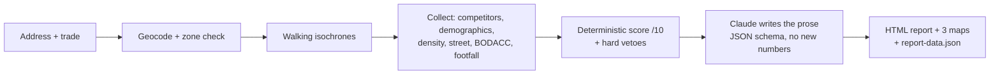

# VisiSpot

**Location intelligence for independent retailers.** Give it an address and a trade, get back a sourced, print-ready report with a clear verdict: **VIABLE** or **NON VIABLE**.

Franchises and retail chains decide where to open with location analysts and paid data. The independent baker, florist or hairdresser signing a nine-year commercial lease usually decides on gut feeling. VisiSpot gives them the same kind of evidence, in plain language, for the price of a few hours of a consultant's time.

> MVP, France only. 17 trades, one command per report, ~30 to 60 seconds and ~€0.06 of LLM cost per report.

---

## What a report answers

| Page | Question | Main sources |
|---|---|---|
| P1 | Should I open here? Score /10, verdict, 4 key metrics | Deterministic scorer |
| P2 | What is the street like? Street type, transit, parking, visibility | OpenStreetMap |
| P3 | Who lives within a 5 and 10 minute walk? Population, age, income, housing | INSEE (census, Filosofi), IRIS contours |
| P4 | Who am I up against? Direct competitors vs chains, mapped | Google Places, cross-checked with OSM |
| P5 | Does the trade fit the area? Revenue range per outlet, target profile, seasonality | Sector benchmarks (FCGA, Cerfrance, INSEE) |
| P6 | What are the warning signs? Business openings, closures, insolvencies | BODACC |

Every figure carries its source and its data vintage. Anything estimated rather than measured is labelled as such.

---

## How it works



`assemble-report.js` orchestrates the whole pipeline. Each step is an isolated module with its own runner, so any stage can be tested alone against a real address.

---

## Design principles

The interesting part of this project is not calling APIs. It is deciding what to trust when ten heterogeneous sources disagree, are capped, are stale, or are silently empty.

**1. The LLM writes. It never scores.**
The score, the verdict and the key metrics come from `scoring.js`, a pure function with an inspectable `score_breakdown`: four weighted pillars (competition 35%, demographics 30%, footfall 20%, risks 15%), a viability threshold of 5.5 and hard vetoes. Claude (Sonnet 4.6, structured JSON output) only turns those facts into readable prose and cannot change a number. An earlier version let the model emit the score; it was not reproducible and was replaced.

**2. Uncertainty must never improve the score.**
"Zero competitors" is worth 10/10 on the heaviest pillar, which makes it the most dangerous input when it actually comes from a failed query. Two guards:
- *OSM contradiction*: zero results from Google while OpenStreetMap lists 3+ shops of the same trade becomes "Undetermined", neutral score, visible data warning. The check is asymmetric: a low OSM count can challenge an absence, never confirm one.
- *Right-censoring*: Google returns at most 20 places. A full result page is treated as a lower bound, never as "no competition", and the score is capped.

**3. Entity resolution is where the bugs live.**
Competitor detection merges two search modes (Nearby and keyword Text Search), deduplicates by place ID then by name and proximity (< 25 m), separates chains from independents, and runs a cross-sector contamination check. Two production bugs came from this layer: a wildcard type rule that excluded a sector's own types (1 competitor found instead of 6), and a trade Google does not type distinctly (0 competitors found instead of 11). Service format is read separately from cuisine (`fast_food_restaurant` vs `hamburger_restaurant`), because the two are encoded differently.

**4. Provenance and vintage are part of the output.**
Demographics use the most recent vintage INSEE publishes at the IRIS level, per dimension (census 2022 for population and housing, Filosofi 2021 for income, because 2022 was skipped and 2023 is not published at that grain). Methodologies that are not comparable are never mixed. IRIS contours are pinned to 2024 to stay aligned with the census. Isochrone demographics are area-weighted, which fixed a 6x overestimate on small towns.

**5. An honest gap beats an invented number.**
9 of 17 trades have a sourced revenue benchmark. The other 8 are explicitly marked "proposal" until a credible per-outlet source exists. Footfall falls back to a qualitative proxy badged "estimated, not measured". Commercial rent reference is shown as "not available" because the only free source (DVF) records sale prices, not rents.

**6. One source of truth per question, checked at boot.**
The 17 trades must match across the form, the config, the type mapping, the benchmarks and the exclusion lists. A startup assertion fails loudly if they diverge.

---

## Data sources

| Source | Used for | Access |
|---|---|---|
| Google Places API (New) | Competitors, geocoding | Key |
| OpenStreetMap / Overpass | Commercial density, street context, vacant shops | Open |
| INSEE census RP 2022, Filosofi 2021 | Demographics at IRIS level | Open (local CSV) |
| OpenDataSoft | IRIS contours, BODACC legal notices | Open |
| geo.api.gouv.fr | Zone validation (minimum population) | Open |
| Openrouteservice | 5 and 10 minute walking isochrones | Key (free) |
| BestTime | Footfall proxy | Key (credits) |
| Mapbox Static Images | 3 report maps | Key (free tier) |
| DVF (etalab) | Market reference, best effort | Open |
| Claude API | Report prose | Key |

---

## What did not work (yet)

Competition thresholds are the weakest part of the model, and the reasons are documented rather than hidden:

- An absolute threshold cannot be right: the measurement is capped at 20, it is not normalised by demand, and trades have different national densities (hairdressers are ~2.5x denser than bakeries everywhere in France).
- Measured on 6 contrasting zones, 4 thresholds were clearly broken and fixed. The other 13 are unchanged for lack of evidence.
- Three calibration approaches were tried and two were invalidated: national SIRENE ratios (legal units, not shops), NAF-code densities (one code can cover florists, garden centres and pet shops) and quantile calibration on our own measurement (too costly and too slow to sample at scale).

Next clean option: INSEE's BPE (permanent facilities database), which counts actual points of sale. What would help most is ground truth: 5 to 10 real locations with a known outcome.

---

## Quickstart

Requirements: Node.js 20.19+, macOS or Linux. **Zero npm dependencies**: native `fetch`, hand-written geometry, CSV parsing and tests.

```bash
git clone https://github.com/valfeist/visispot.git
cd visispot
cp .env.example .env    # add your API keys
# download the INSEE CSVs into data/ (~130 MB, not versioned)

node assemble-report.js "10 Rue Sainte-Catherine, 33000 Bordeaux, France" coiffure 60 1800
```

Arguments: `"<full address>" <trade> [surface_m2] [monthly_rent]`. Output goes to `output/<date_address-slug>/`: open `report.html` and print to PDF.

Iterate on the template without calling any API:

```bash
node rebuild-report.js <report-folder>
```

### Tests

45 offline tests (`node:assert`, no network, no keys):

```bash
node test/score.test.js
node test/bodacc.test.js
node test/competitor-classify.test.js
node test/sector-keys.test.js
node test/iris-weight.test.js
```

### Supported trades

| Family | Trades |
|---|---|
| Food service | `restauration` · `snacking` · `cafe` |
| Food retail | `boulangerie` · `boucherie` · `poissonnerie` · `primeur` · `fromagerie` · `epicerie_fine` · `caviste` |
| Beauty & care | `coiffure` · `beaute` |
| Everyday services | `pressing` · `laverie` · `retouche` · `cordonnerie` · `fleuriste` |

Business values (trade keys, report text) are in French; code, comments and commits are in English.

---

## Status and roadmap

Working end to end, validated on real addresses for all 17 trades, not only in offline tests.

Next: real customer intake form (currently simulated), email delivery with verdict-based templates, automatic PDF rendering, a commercial rent source, roadwork open data for large cities, sourced benchmarks for the remaining 8 trades.

---

## About

Built by [Valentin Feist](https://github.com/valfeist), a marketing and GTM operator, as a solo zero-to-one project with Claude Code as an engineering partner. The working rules for that collaboration live in [`CLAUDE.md`](CLAUDE.md) and [`CONVENTIONS.md`](CONVENTIONS.md): one change per commit, deterministic logic over model judgement, no invented figures.
